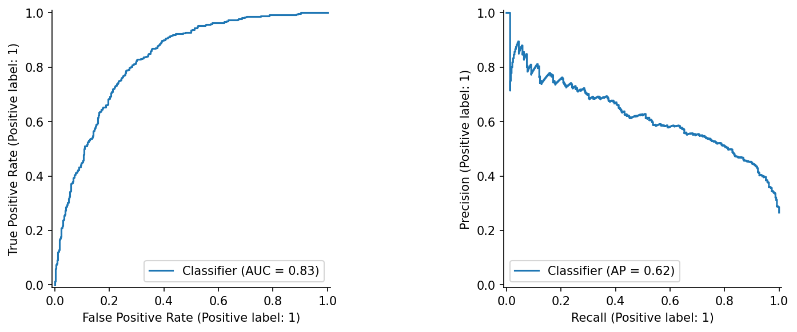

# A churn model is only useful when the review queue is useful
## A CRISP-DM project that measures the decision, not just accuracy

A telecom team rarely has the resources to call every customer. For this project, the imagined constraint was a review queue covering at most 20% of a batch. That changes the modeling question: can a score concentrate observed churn cases in a manageable queue?

The project uses the [Kaggle Telco Customer Churn dataset](https://www.kaggle.com/datasets/blastchar/telco-customer-churn) and follows the six phases of [CRISP-DM](https://www.ibm.com/docs/en/spss-modeler/saas?topic=dm-crisp-help-overview). The result is an executed notebook, a documented evaluation, and a batch-scoring prototype. It is not a claim that an actual company reduced churn.

## Start with the constraint

The technical target was a lift of at least two in the highest-scoring 20%. Lift compares the queue's churn rate with the overall churn rate. It is more directly connected to a limited review budget than accuracy alone. The target is an explicit assumption for this teaching project.

Business understanding also exposed a limit: the data do not contain campaign treatment or response. A customer likely to churn is not necessarily a customer whose behavior can be changed by a phone call. A real retention program needs an experiment.

## The quiet data-quality problem

There are 7,043 customer rows. Although total charges look numerical, the CSV stores them as text and includes blanks. Converting them to numbers revealed 11 missing values. Those rows were retained and imputed from training data, rather than quietly discarded.

Customer IDs were removed from predictors. Gender and senior status were reserved for diagnostics. A stratified split placed 60% of the rows in training and 20% each in validation and testing. Imputation, scaling and one-hot encoding were fitted inside each training fold to prevent leakage.

## Compare credible alternatives

The experiments compared a prevalence baseline, regularized logistic regression and a random forest. Three-fold cross-validation tuned each learned model. Validation average precision selected logistic regression with C=1.0, although the difference from the forest was small. That is a result of this experiment, not a universal ranking of algorithms.

## What the held-out queue contained

On the 1,409-row test set, average precision was 0.622 and ROC AUC was 0.832. The top-20% queue contained 281 customers. Its churn rate was 61.6%, and it captured 46.3% of all observed churn cases. The resulting lift was 2.32.

A 500-resample bootstrap gave a lift interval of 2.15 to 2.56. This describes uncertainty under the observed sample, holding the model fixed. It does not account for a changing market or a future billing system.

## A passing metric is not a deployment certificate

The subgroup audit showed a reason for caution. At the diagnostic 0.5 threshold, the senior group's false-positive rate was about 26.3%, versus 9.9% for the other group. Removing a demographic column did not eliminate group differences. The threshold audit also describes a different decision rule from the ranked queue, so it cannot certify the operational policy.

The deliverable includes the full fitted pipeline, input schema, sample batch and output audit. The scorer applies a strict floor(20% × batch size) budget. Missing required columns and invalid numbers are rejected; unfamiliar categories and values outside training ranges are flagged.

The next step would be a current, correctly timed dataset and a monitored pilot with human review. To claim retention benefit, the team would need randomized evidence and contact-cost measurement. The central lesson of this project is that a strong ranking score is useful evidence, but it is only one part of a responsible decision process.

*AI assistance disclosure: Codex helped implement, critique and draft this project. Numerical results were executed locally. Automated checks verified execution and saved-model behavior; this does not substitute for independent human review.*

## Code and video

[Project repository](https://github.com/saliherenyuzbazzozlu/data-mining-methodologies/tree/main/crisp_dm) · [Video walkthrough](https://youtu.be/RpL7WDW_gsY)
