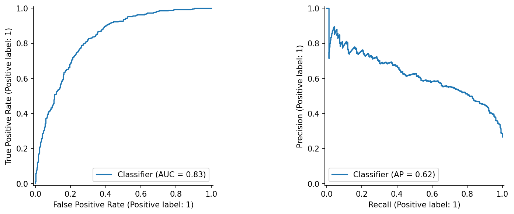
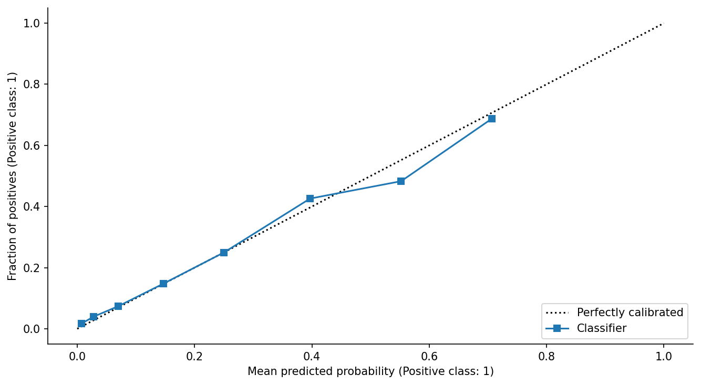

# CRISP-DM — Telecom churn prioritization

CMPE-255 • Data mining process assignment • November 3, 2026

Run all cells in order. This notebook is self-contained and Colab-compatible. It uses the bundled CSV when present; otherwise it downloads the exact public Kaggle dataset and checks its SHA-256. Figures, fitted pipelines, and evaluation tables are written to `artifacts/`. Results stored in this notebook were executed locally; a hosted Colab run remains a separate verification. AI assistance: Codex; see the review record and student verification checklist.

## 1. Business understanding
### Objectives, situation, mining goals, and project plan
A hypothetical retention team can review at most 20% of a customer batch. The objective is to concentrate observed churn cases in that review queue. The operational proxy is **lift at 20% ≥ 2**, with average precision above prevalence; a pilot still requires current data and experimental validation. These targets are design assumptions, not a real company commitment.

The sponsor would be a retention manager, the data steward a billing analyst, and the operator a customer-care lead. The available resource is a historical Kaggle teaching dataset and a CPU runtime; there is no campaign response, intervention cost, profit, or timestamped outcome window. Consequently this project estimates cross-sectional churn association, not a verified next-month forecast or causal retention benefit. Cost savings cannot be claimed.

Plan: audit data → lock stratified 60/20/20 split → training-only EDA and CV → validation selection → one final test → batch scoring demonstration → monitored pilot plan. Main risks are timing leakage, changed customer behavior, group disparities, and poor calibration. Success requires reproducibility and honest reporting even when a gate fails.

## 2. Data understanding
### Collection and description
Source: [Kaggle Telco Customer Churn](https://www.kaggle.com/datasets/blastchar/telco-customer-churn). A row represents a customer. `Churn` is the Yes/No outcome; services, billing, contract and tenure describe that customer. ID is a join key, not a predictor. Gender and senior status are retained only for diagnostics. Dataset provenance is included beside the raw CSV.

### Quality verification and initial exploration
Convert blank `TotalCharges` to missing numeric values before measuring quality. Check IDs, labels and nonnegative monetary/tenure fields. A row with missing total charges may be a newly enrolled customer, so median imputation is preferable to silently deleting the row. The full-data audit is restricted to structural quality; relationship exploration uses training rows.

## 3. Data preparation
### Selection, cleaning, construction, integration and formatting
Exclude `customerID`, `Churn`, `gender`, and `SeniorCitizen` from predictors. This reduces direct demographic use but does not guarantee fairness: other variables can be proxies. One source is used; no external join is needed. Integrate labels by preserved row index, not position after sorting.

Numeric features are median-imputed and standardized. Other columns are imputed with their training mode and one-hot encoded, allowing unseen categories at prediction time. Existing service categories are meaningful, including “No internet service”; they are preserved. No target-driven feature filtering or outlier removal is applied. Learned preprocessing is inside the pipeline and refit within every CV fold. One-hot columns are the constructed features; additional tenure/charge ratios are avoided because they are redundant and introduce undefined division at zero tenure.

## 4. Modeling
### Technique selection, test design, model building and assessment
The baseline returns training prevalence. Logistic regression supplies an interpretable additive benchmark; a forest can capture nonlinear interactions. Use three-fold stratified CV on training rows, tuning C for logistic regression and leaf size for the forest. Average precision (AP) is the training selection metric because positive outcomes are less common. Validation AP selects between the tuned families; ties favor the simpler logistic model. No test result is used for this choice. Keep the training fit unchanged after selection so validation and test comparisons have the same training budget.

## 5. Evaluation
### Results, process review, and next steps
The contact policy selects the highest-scoring floor(0.20×N) customers in each batch, with stable input-order tie breaking. This is a rank policy, not a probability cutoff optimized on test data. The confusion matrix uses a separate, fixed 0.5 threshold for diagnostic reporting.

Evaluate discrimination, probability quality, and ranking value; estimate a 95% percentile bootstrap interval with 500 resamples. This interval conditions on the trained model and this sample design, so it excludes retraining and future-distribution uncertainty. Group metrics are diagnostic and may be noisy; excluding demographics is not a fairness certification. Business readiness requires both the proxy gate and current, correctly timed data. A randomized contact pilot is needed to establish intervention benefit.

## 6. Deployment
### Deployment plan and executed handoff
Export the complete preprocessing/model pipeline, schema, frozen policy, sample input, and sample predictions. The local batch demo is the deployment artifact; no public service or real customer campaign is claimed. Load only trusted joblib files. A production integration would score a newly validated, pre-outcome snapshot, rank by probability, and let customer-care staff review the top 20%.

### Monitoring and maintenance
Suggested owner: customer-care analytics. On every batch, reject missing required columns or invalid negative numerical values; report unknown category rate and numeric drift. Review weekly: missingness >5%, unknown categories >1%, and population stability index >0.2 trigger investigation. When outcomes mature, compare AP/lift and calibration with this benchmark; a lift below 2 for two batches pauses the pilot. These are proposed thresholds, not empirically calibrated alerts. Retraining requires a new time-separated holdout and approval from the operational owner. Roll back to no model-driven prioritization if quality checks fail.

### Final report and project review
See `report.md`, `article_medium.md`, and `walkthrough.md`. Limitations include historical teaching data, unknown timing, associations rather than causal effects, and untested production generalization. The technical outcome is a reproducible ranking prototype and an explicit decision gate, not demonstrated retention savings.

## Measured results and decision
The validation rule selected logistic regression with C=1.0. Its validation AP was 0.6771; the forest's was 0.6747. That small difference does not establish that logistic regression is inherently better. The untouched test AP was 0.6222, versus prevalence-baseline AP 0.2654, and ROC AUC was 0.8323. Brier score was 0.1415 versus 0.1950, where lower is better.

With a strict 20% review budget, 281 of 1,409 test customers were selected. Their observed churn fraction was 61.6%; this queue contained 46.3% of all test churn cases. Lift was 2.319, above the assumed target of 2. The bootstrap 95% intervals were 0.571–0.674 for AP and 2.150–2.565 for lift. They describe sample uncertainty conditional on this fitted model, not expected future campaign outcomes.

The random-order prevalence baseline has a measured top-20% lift slightly above one because all scores tie and input order breaks ties. Its expected lift under random ordering is one. This is not meaningful learned ranking.

The proxy performance gate passes, but operational approval remains **pilot only, after new-data timing and group review**. At a fixed diagnostic threshold of 0.5, senior customers had a false-positive rate of 0.263 versus 0.099 for the other group. Female and male rates were 0.152 and 0.091. These differences warrant review and are not removed merely by excluding gender and senior status from the predictors. Group prevalence also differs. The top-20% selection policy is a different decision rule; threshold diagnostics cannot certify it as fair.

The model has not demonstrated fewer cancellations. A risk score identifies an association, while a retention campaign needs evidence that an intervention changes an outcome. The next experiment should randomize eligible customers to a reviewed intervention/control design and measure incremental retention, contact burden and cost. The present teaching data cannot provide these quantities.

### Candidate comparison
| model         |   cv_AP |   validation_AP | parameters                      |
|:--------------|--------:|----------------:|:--------------------------------|
| logistic      |  0.6636 |          0.6771 | {'model__C': 1.0}               |
| random_forest |  0.6645 |          0.6747 | {'model__min_samples_leaf': 10} |

### Group diagnostics at 0.5
| attribute     | group   |    n |   prevalence |     AP |   TPR_0.5 |   FPR_0.5 |
|:--------------|:--------|-----:|-------------:|-------:|----------:|----------:|
| gender        | Female  |  714 |       0.2899 | 0.6115 |    0.5266 |    0.1519 |
| gender        | Male    |  695 |       0.2403 | 0.6389 |    0.5210 |    0.0909 |
| SeniorCitizen | 0       | 1170 |       0.2325 | 0.6071 |    0.5074 |    0.0991 |
| SeniorCitizen | 1       |  239 |       0.4268 | 0.6654 |    0.5686 |    0.2628 |

### Validation permutation importance
| feature          |   AP_drop |     sd |
|:-----------------|----------:|-------:|
| tenure           |    0.2773 | 0.0056 |
| InternetService  |    0.0755 | 0.0119 |
| TotalCharges     |    0.0545 | 0.0132 |
| Contract         |    0.0523 | 0.0147 |
| MonthlyCharges   |    0.0371 | 0.0071 |
| PaperlessBilling |    0.0158 | 0.0039 |
| PaymentMethod    |    0.0127 | 0.0088 |
| TechSupport      |    0.0115 | 0.0082 |
| OnlineSecurity   |    0.0090 | 0.0093 |
| MultipleLines    |    0.0081 | 0.0049 |
| StreamingMovies  |    0.0074 | 0.0049 |
| PhoneService     |    0.0026 | 0.0017 |
| StreamingTV      |    0.0011 | 0.0047 |
| Dependents       |    0.0002 | 0.0046 |
| Partner          |   -0.0002 | 0.0002 |
| DeviceProtection |   -0.0007 | 0.0041 |
| OnlineBackup     |   -0.0008 | 0.0056 |

Importance is the validation AP change when a raw input column is permuted. Correlated features can share importance, and importance does not imply a causal lever.

## Data audit appendix

| Unnamed: 0       | dtype   |   missing |   unique |
|:-----------------|:--------|----------:|---------:|
| customerID       | object  |         0 |     7043 |
| gender           | object  |         0 |        2 |
| SeniorCitizen    | int64   |         0 |        2 |
| Partner          | object  |         0 |        2 |
| Dependents       | object  |         0 |        2 |
| tenure           | int64   |         0 |       73 |
| PhoneService     | object  |         0 |        2 |
| MultipleLines    | object  |         0 |        3 |
| InternetService  | object  |         0 |        3 |
| OnlineSecurity   | object  |         0 |        3 |
| OnlineBackup     | object  |         0 |        3 |
| DeviceProtection | object  |         0 |        3 |
| TechSupport      | object  |         0 |        3 |
| StreamingTV      | object  |         0 |        3 |
| StreamingMovies  | object  |         0 |        3 |
| Contract         | object  |         0 |        3 |
| PaperlessBilling | object  |         0 |        2 |
| PaymentMethod    | object  |         0 |        4 |
| MonthlyCharges   | float64 |         0 |     1585 |
| TotalCharges     | float64 |        11 |     6530 |
| Churn            | object  |         0 |        2 |

## References and review evidence

- [IBM CRISP-DM overview](https://www.ibm.com/docs/en/spss-modeler/saas?topic=dm-crisp-help-overview)
- [Course lecture slides](https://docs.google.com/presentation/d/1NozxdUtcAWOBq-VVkrJwy5mK4EHAjR1vhhbF50APS8c/edit#slide=id.p27)
- [Telco dataset](https://www.kaggle.com/datasets/blastchar/telco-customer-churn)

See [all assignment links](../LINK_REVIEW.md), [first critique and revisions](../PLANNING_AND_REVIEW.md), and [second critique and revisions](../FINAL_REVIEW.md). Numeric claims above come from the executed notebook and saved artifacts, not from the example repositories.
