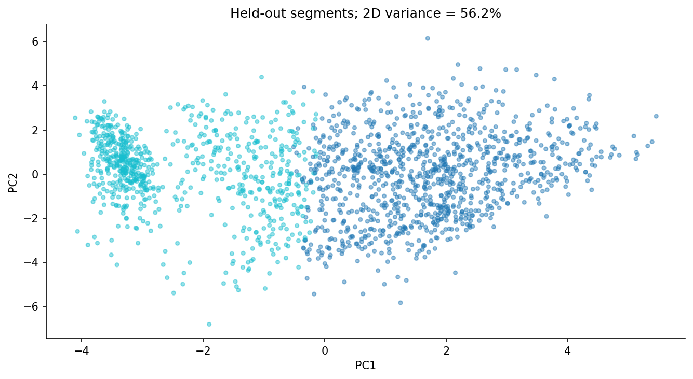

# When two customer segments are more defensible than five
## A KDD project that tests whether the pattern survives

Clustering software will produce labels even when the labels are not useful. The challenge is deciding whether a partition is stable, interpretable and relevant to a real question.

This project uses the [Kaggle Credit Card Dataset for Clustering](https://www.kaggle.com/datasets/arjunbhasin2013/ccdata) to explore historical usage patterns. It follows the broader [KDD process described by Fayyad and colleagues](https://www.ai.rug.nl/ki2/literature/kdd-fayyad-shapiro-smyth.pdf): understand the domain, select and prepare data, choose and run mining methods, interpret the patterns, and decide how the knowledge could be used.

## Define what the clusters are for

The proposed use is service-design research. A useful partition could help organize customer interviews about different product functions. It is not a credit-risk model and must not be used to decide who receives a loan, a limit increase or a price.

There are 8,950 customer rows, with balances, purchases, payments, transaction counts, frequencies and tenure. No default outcome, experimental treatment or demographic description is available. Those absences constrain the conclusions.

## Let a failed check change the plan

The initial audit found missing minimum payments and one missing credit limit. It also found eight cash-advance-frequency values above one, with a maximum of 1.5. That conflicted with the intended proportion interpretation.

Rather than silently clipping the values, the revised analysis excluded the ambiguous frequency column and retained cash-advance amount and transaction count. The raw file and the exclusion decision remain in the repository. This is a small example of KDD iteration: a quality finding changes the target representation before mining proceeds.

## Compare representations and algorithms

Customer identifiers were excluded from distance calculations. The data were split 60/20/20 into discovery, validation and final test partitions. All imputation and transformations were fitted only on discovery rows.

Money and count variables have long tails, so the analysis compared raw standardization with log1p followed by standardization. K-means was tested with two through six clusters under both representations. A diagonal Gaussian mixture supplied another algorithm on the log representation.

The fixed selection rule maximized validation silhouette while requiring every cluster to contain at least 5% of validation rows. It selected two-cluster log-transformed K-means. A larger number of labels might be easier to turn into a colorful marketing story, but the stated metric did not support forcing that choice.

## Separate stability from separation

The test silhouette was 0.246. The two groups represented 58.5% and 41.5% of the test sample. Five refits on 80% discovery subsamples, including re-fitting preprocessing, produced a median validation adjusted Rand index of 0.987.

The high ARI indicates a stable partition under that resampling design. The moderate silhouette says the geometry is not perfectly separated. These are different properties and both belong in the report.

The plot uses two PCA components, which capture 56.2% of transformed discovery variance. The actual assignments use all sixteen eligible variables; the picture is only a compressed view.

## Turn labels into bounded knowledge

Cluster 0 had median purchases of 862.22, purchase frequency of 0.909 and zero cash advance. Cluster 1 had median purchases of zero and median cash advance of 915.48. Those medians support the working descriptions “purchase-active” and “low-purchase/cash-advance” profiles.

They do not establish wealth, financial distress, causality or a universal customer taxonomy. They also do not say that every member follows the median behavior. An appropriate next step is to interview consenting participants from both profiles and test proposed service changes independently.

The final handoff includes the assignment pipeline, schema, profile tables and a batch-scoring demo. Monitoring should examine missingness, numerical ranges and changing group shares. A model update also needs a review of the group descriptions, because cluster numbers can change between fits.

The discovery is therefore a reproducible pattern with a follow-up question. That is more defensible than presenting an arbitrary list of customer personas as established knowledge.

*AI assistance disclosure: Codex helped implement, critique and draft this project. Results were executed locally; automated verification is documented separately from independent human review.*

## Code and video

[Project repository](https://github.com/saliherenyuzbazzozlu/data-mining-methodologies/tree/main/kdd) · [Video walkthrough](https://youtu.be/XXwhyxQ5_nw)
