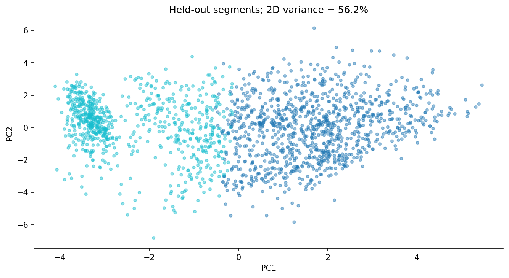
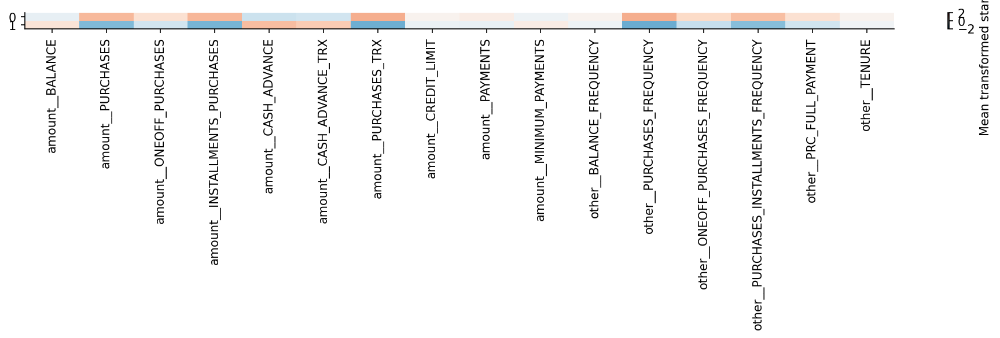

# KDD — Discovering card usage segments

CMPE-255 • Data mining process assignment • November 3, 2026

Run all cells in order. This notebook is self-contained and Colab-compatible. It uses the bundled CSV when present; otherwise it downloads the exact public Kaggle dataset and checks its SHA-256. Figures, fitted pipelines, and evaluation tables are written to `artifacts/`. Results stored in this notebook were executed locally; a hosted Colab run remains a separate verification. AI assistance: Codex; see the review record and student verification checklist.

## 1. Domain understanding and discovery goal
Discover reproducible, understandable usage patterns in a historical customer dataset to inform hypothetical service-design research. A useful result must have measurable separation and stability, interpretable original-unit profiles, and a plausible follow-up question. It does not identify true customer types or prove which promotion works. No cluster is a credit-risk rating, and the prototype must not determine lending eligibility, credit limits, prices, or access to services.

This notebook uses the nine-step KDD formulation, mapped to the common five-stage diagram: selection (steps 1–2), preprocessing (3), transformation (4), data mining (5–7), and interpretation/evaluation plus knowledge use (8–9). KDD is iterative; a failure of stability returns the work to representation or algorithm selection rather than just renaming clusters.

## 2. Create the target dataset — selection
Source: [Kaggle Credit Card Dataset for Clustering](https://www.kaggle.com/datasets/arjunbhasin2013/ccdata). Each row is an anonymized customer usage summary. Monetary values, transaction counts, frequencies and tenure are available; acquisition dates, demographics, outcomes and treatment responses are not. Exclude `CUST_ID` from distance calculations. Keep it only as a local join key. No external integration is necessary.

Reserve 20% for final evaluation and 20% for representation/k selection, with 60% for discovery. This random split assesses within-source repeatability, not future-time transportability. There is no supervised target and no meaningful classification accuracy.

## 3. Clean and preprocess
Missing `MINIMUM_PAYMENTS` and `CREDIT_LIMIT` are median-imputed from discovery rows inside the pipeline. Missing does not mean zero payments. The raw audit found eight `CASH_ADVANCE_FREQUENCY` values above 1 (maximum 1.5), contradicting the assumed proportion scale. Without source clarification, exclude this ambiguous field rather than clip or reinterpret it. Retain cash-advance amount and count. Remaining frequency/proportion fields must be within [0,1]; counts and monetary quantities must be nonnegative. There are no duplicate IDs. High spend is not automatically an error, so valid extremes remain. No source chronology is available and no time-window correction can be claimed.

Inspect discovery-only distributions and missingness. Heavy tails motivate a comparison of raw standardization with log1p plus standardization. The experiment is specified before test access.

## 4. Reduce/project and transform
After excluding ID and the ambiguous frequency field, the primary clustering retains all 16 eligible predictors. Money and transaction-count columns are eligible for log1p transformation; frequency and tenure columns retain their original form before standardization. Log1p handles zero and reduces heavy-tail influence. Scaling is necessary because dollars and fractions otherwise have incompatible distances.

Compare this representation with raw standardization. Both are fit solely on discovery data. PCA is later fit on transformed discovery rows for a two-dimensional plot; its explained variance is reported and the projection is not evidence of separation in all dimensions.

## 5. Choose the mining task
The task is unsupervised clustering and descriptive profiling. Classification is inappropriate because no target is supplied. Association mining would require defensible transaction/basket semantics absent from this customer-level table; it is not added merely to generate more output.

## 6. Choose algorithms and selection rules
K-means offers reproducible nearest-centroid assignment. Compare k=2 through 6 for both representations. A diagonal-covariance Gaussian mixture with k=2 through 6 provides a different clustering assumption on the log representation. All models are trained on discovery rows and ranked by validation silhouette, subject to every validation cluster having at least 5% of rows. Silhouette prefers well-separated geometry and can favor coarse k; report this rather than forcing a visually attractive segment count. Davies–Bouldin and resampling stability provide complementary evidence. If no candidate meets the minimum share, the fallback is exploratory only.

## 7. Mine the data
Save every candidate's metrics and hyperparameters. The selected pipeline is frozen before final test evaluation. A five-resample check refits preprocessing and the algorithm on 80% discovery subsamples and compares validation assignments with the frozen solution using adjusted Rand index (ARI). This tests partition sensitivity without requiring numeric cluster IDs to align.

## 8. Interpret and evaluate patterns
Test silhouette and Davies–Bouldin are computed on held-out transformed rows assigned by the frozen model. The pilot proxy gate requires silhouette ≥0.20, minimum test cluster share ≥5%, and median validation resampling ARI ≥0.70. These are explicitly assumed criteria for the teaching example, not universal clustering standards.

Profiles report counts and medians in original units; a standardized profile chart aids comparison. Cluster numbers have no ordinal meaning. Profile differences are descriptive because the algorithm was designed to separate these very variables. They are not significance tests or independent causal findings. A PCA view compresses information and must be interpreted with its explained variance. Potential actions are hypotheses for stakeholder interviews and controlled tests.

## 9. Consolidate and act on knowledge
Deliver a report, original-unit segment profiles, a fitted assignment pipeline, a schema and a reproducible sample batch. A stakeholder can use these to design interviews about usage patterns. Do not infer debt stress, wealth, demographics or creditworthiness from cluster membership. The artifact supports service research only; no customer-level action is executed.

The local batch scorer demonstrates how new records receive cluster assignments after identical preprocessing. Proposed owner: product research analytics. Monitor monthly changes in segment shares, missingness, new numeric ranges and distance/distribution shifts; a >10 percentage-point share change or >5% missingness triggers investigation. Rerun stability checks before replacing the model, align new cluster descriptions explicitly, and retain the previous version for rollback. If the proxy gate fails, the proper next step is to revisit representation and goal with fresh data, not to claim deployable customer types.

See `report.md` for measured interpretations and `article_medium.md` for a communication draft. The next empirical step is a new, appropriately sampled dataset and stakeholder validation, followed by a controlled study of any proposed service change.

## Measured results and knowledge statement
The chosen candidate was `log_kmeans_2`: log-transformed K-means with two clusters. The algorithm considered 15 candidates: five k values for raw-standardized K-means, five for log-standardized K-means, and five for log-standardized diagonal Gaussian mixtures. Validation silhouette, subject to a 5% minimum group share, selected the final candidate.

On 1,790 untouched test rows, silhouette was 0.2463 and Davies–Bouldin was 1.5759. The groups contained 1,048 and 742 rows (58.5% and 41.5%). Median validation ARI across five 80% discovery subsamples was 0.9866. This means the partition was stable under this particular resampling check, but the silhouette indicates only moderate geometric separation. Both observations are necessary; stability alone does not validate the meaning or usefulness of a cluster.

The first two PCA components explain 56.2% of transformed discovery variance. Therefore, the plot omits a substantial amount of structure. Cluster assignments are computed in all 16 transformed input dimensions, not from the two-dimensional visualization.

The original-unit test profiles support descriptive working names:

- **Cluster 0 — purchase-active profile:** median purchases 862.22, purchase frequency 0.909, 14 purchase transactions, and zero cash advance. This is a useful interview stratum for understanding purchase-service usage.
- **Cluster 1 — low-purchase/cash-advance profile:** median purchases and purchase frequency are zero, while median cash advance is 915.48 and cash-advance transaction count is 3. This can motivate questions about how customers use different product functions.

These are medians, not statements that every member behaves the same way. Neither group is labeled wealthy, distressed, good, bad, or risky. Median payments, balances and credit limits are descriptive historical fields and are not used to make lending decisions. There is no default target or causal intervention outcome.

### Candidate comparison
| candidate    | representation   | algorithm   |   k |   silhouette |   davies_bouldin |   minimum_share |
|:-------------|:-----------------|:------------|----:|-------------:|-----------------:|----------------:|
| raw_kmeans_2 | raw              | kmeans      |   2 |       0.2190 |           1.8308 |          0.4140 |
| raw_kmeans_3 | raw              | kmeans      |   3 |       0.1954 |           1.7084 |          0.0615 |
| raw_kmeans_4 | raw              | kmeans      |   4 |       0.2061 |           1.5497 |          0.0346 |
| raw_kmeans_5 | raw              | kmeans      |   5 |       0.2014 |           1.5293 |          0.0101 |
| raw_kmeans_6 | raw              | kmeans      |   6 |       0.2076 |           1.4839 |          0.0101 |
| log_kmeans_2 | log              | kmeans      |   2 |       0.2445 |           1.6056 |          0.4039 |
| log_kmeans_3 | log              | kmeans      |   3 |       0.2302 |           1.6640 |          0.2983 |
| log_kmeans_4 | log              | kmeans      |   4 |       0.2277 |           1.6251 |          0.1464 |
| log_kmeans_5 | log              | kmeans      |   5 |       0.2107 |           1.6217 |          0.1352 |
| log_kmeans_6 | log              | kmeans      |   6 |       0.2246 |           1.4826 |          0.1095 |
| log_gmm_2    | log              | gmm         |   2 |       0.2337 |           1.6156 |          0.3654 |
| log_gmm_3    | log              | gmm         |   3 |       0.1756 |           1.8801 |          0.2184 |
| log_gmm_4    | log              | gmm         |   4 |       0.1486 |           2.5289 |          0.1447 |
| log_gmm_5    | log              | gmm         |   5 |       0.1703 |           2.3861 |          0.1112 |
| log_gmm_6    | log              | gmm         |   6 |       0.1698 |           2.3209 |          0.0777 |

### Original-unit profiles (selected fields)
|   cluster |        n |   PURCHASES |   PURCHASES_FREQUENCY |   CASH_ADVANCE |   PURCHASES_TRX |   CASH_ADVANCE_TRX |
|----------:|---------:|------------:|----------------------:|---------------:|----------------:|-------------------:|
|     0.000 | 1048.000 |     862.220 |                 0.909 |          0.000 |          14.000 |              0.000 |
|     1.000 |  742.000 |       0.000 |                 0.000 |        915.483 |           0.000 |              3.000 |

**Knowledge-use decision:** the assumed stability/separation gate passes for exploratory service research. A concrete follow-up is to recruit consenting interview participants from both profiles and ask which existing service functions they use and why. Any proposed product change should then be tested independently. High ARI does not prove that a promotion increases engagement or that these two clusters are universally meaningful customer types.

## Data audit appendix

| Unnamed: 0                       | dtype   |   missing |   unique |
|:---------------------------------|:--------|----------:|---------:|
| CUST_ID                          | object  |         0 |     8950 |
| BALANCE                          | float64 |         0 |     8871 |
| BALANCE_FREQUENCY                | float64 |         0 |       43 |
| PURCHASES                        | float64 |         0 |     6203 |
| ONEOFF_PURCHASES                 | float64 |         0 |     4014 |
| INSTALLMENTS_PURCHASES           | float64 |         0 |     4452 |
| CASH_ADVANCE                     | float64 |         0 |     4323 |
| PURCHASES_FREQUENCY              | float64 |         0 |       47 |
| ONEOFF_PURCHASES_FREQUENCY       | float64 |         0 |       47 |
| PURCHASES_INSTALLMENTS_FREQUENCY | float64 |         0 |       47 |
| CASH_ADVANCE_FREQUENCY           | float64 |         0 |       54 |
| CASH_ADVANCE_TRX                 | int64   |         0 |       65 |
| PURCHASES_TRX                    | int64   |         0 |      173 |
| CREDIT_LIMIT                     | float64 |         1 |      205 |
| PAYMENTS                         | float64 |         0 |     8711 |
| MINIMUM_PAYMENTS                 | float64 |       313 |     8636 |
| PRC_FULL_PAYMENT                 | float64 |         0 |       47 |
| TENURE                           | int64   |         0 |        7 |

## References and review evidence

- [Fayyad, Piatetsky-Shapiro and Smyth (1996)](https://www.ai.rug.nl/ki2/literature/kdd-fayyad-shapiro-smyth.pdf)
- [Course lecture slides](https://docs.google.com/presentation/d/1NozxdUtcAWOBq-VVkrJwy5mK4EHAjR1vhhbF50APS8c/edit#slide=id.p27)
- [Card dataset](https://www.kaggle.com/datasets/arjunbhasin2013/ccdata)

See [all assignment links](../LINK_REVIEW.md), [first critique and revisions](../PLANNING_AND_REVIEW.md), and [second critique and revisions](../FINAL_REVIEW.md). Numeric claims above come from the executed notebook and saved artifacts, not from the example repositories.
