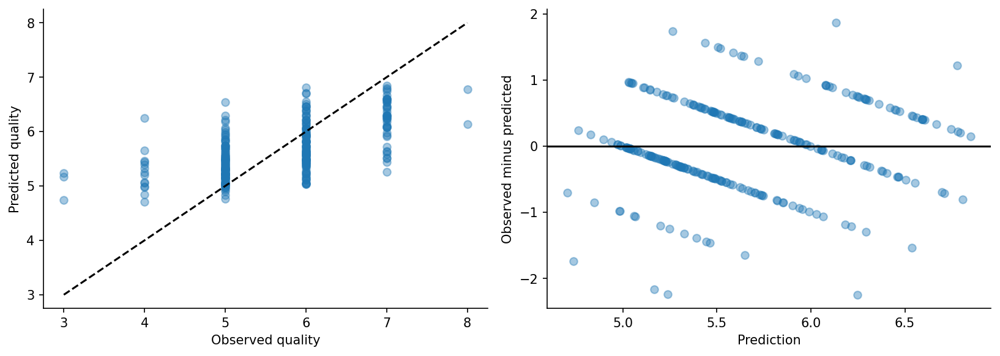

# Predicting wine quality without letting duplicates inflate the result
## A SEMMA workflow from sampling to an honest error analysis

Wine quality prediction makes an appealing regression example: measurements go in, a quality score comes out. But a useful experiment begins earlier than model fitting. It begins with deciding what counts as an independent observation.

This project applies [SEMMA](https://support.sas.com/documentation/cdl/en/emgs/59885/HTML/default/a000167823.htm)—Sample, Explore, Modify, Model and Assess—to the [Kaggle red wine quality dataset](https://www.kaggle.com/datasets/uciml/red-wine-quality-cortez-et-al-2009). The implementation uses Python. An optional SAS mapping accompanies it, but no SAS run is claimed.

## Sample: catch the duplicates first

The CSV has 1,599 rows, including 240 exact duplicates. A naive random split could put the same chemistry profile into both training and evaluation data, making the problem easier than predicting a genuinely unseen profile.

After removing exact duplicates, 1,359 rows remained. Identical predictor profiles were assigned a common group so that even matching chemistry with different labels could not cross partitions. The resulting split contained 815 training rows and 272 each for validation and testing. Group-aware cross-validation preserved that rule during tuning.

This does not prove that the dataset represents every wine producer or region. It fixes one identifiable source of leakage while leaving the limits of unknown producer and vintage groups visible.

## Explore: look beyond the average wine

Training histograms and correlations showed how the chemistry variables were distributed and how sensory scores were concentrated near the middle. Valid extremes were retained. A large chemical measurement is not automatically a recording error, and removing unusual wines without a justification would change the population being modeled.

The target is ordinal. Treating it as a number is a practical approximation that assumes adjacent score differences are reasonably comparable. That assumption belongs in the interpretation, not hidden inside a regression call.

## Modify: fit transformations where they belong

Median imputation and standardization were placed inside the pipeline. An optional eight-feature subset was compared with all eleven measurements using training-only selection. The winning model retained all eleven, so there is no claim that dropping features improved this experiment.

## Model: earn the extra complexity

The baseline predicted the training mean. The learned alternatives were ridge regression and a random forest. Three-fold grouped cross-validation tuned the candidate settings; validation RMSE chose the family. The final forest used 150 trees and a minimum leaf size of eight, which limits the temptation to fit very small pockets of data.

## Assess: a better average, a difficult tail

Test RMSE was 0.687 quality points, versus 0.876 for the baseline—a 21.6% reduction. MAE was 0.540, and 88.2% of predictions were within one point. The bootstrap RMSE interval was approximately 0.620 to 0.758.

The error-by-score table tells a less comfortable story. The model overpredicted the three score-3 test wines by about two points on average and underpredicted the two score-8 wines by about 1.54 points. Those counts are too small for reliable population estimates, but they clearly prevent a claim that the model handles every quality level well.

Alcohol and sulphates had the largest validation permutation effects. That means the model relied on them in this dataset. It does not mean that altering either variable will causally improve taste.

## Deliver a tool with a boundary

The saved pipeline accepts a chemistry CSV and returns continuous score estimates. It validates columns, rejects invalid numerical inputs, and flags measurements outside the training range. The accompanying plan preserves sensory evaluation as the authority and calls for prospective validation on new wines before operational use.

The useful outcome is not merely that a forest beat a baseline. It is that the experiment made its unit of evaluation, transformations, assumptions and failure modes inspectable. That is what turns a short regression exercise into a complete SEMMA project.

*AI assistance disclosure: Codex helped implement, critique and draft this work. The results were executed locally. Automated verification is documented separately from independent human review.*

## Code and video

[Project repository](https://github.com/saliherenyuzbazzozlu/data-mining-methodologies/tree/main/semma) · [Video walkthrough](https://youtu.be/eyYKo6OdzqI)
