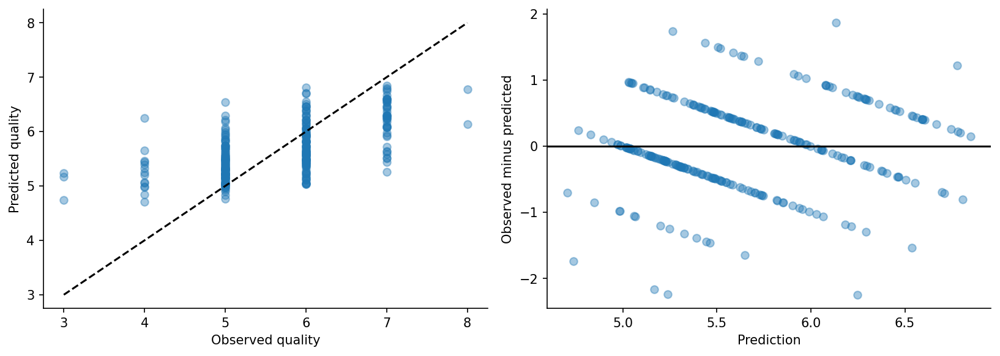

# SEMMA — Red wine quality regression

CMPE-255 • Data mining process assignment • November 3, 2026

Run all cells in order. This notebook is self-contained and Colab-compatible. It uses the bundled CSV when present; otherwise it downloads the exact public Kaggle dataset and checks its SHA-256. Figures, fitted pipelines, and evaluation tables are written to `artifacts/`. Results stored in this notebook were executed locally; a hosted Colab run remains a separate verification. AI assistance: Codex; see the review record and student verification checklist.

## Project context
A hypothetical lab wants a numerical estimate of a sensory quality score from measured chemistry to support review scheduling. Predictions are not a replacement for tasting or product-release decisions. The predeclared technical target is at least a 10% reduction in test RMSE relative to the training-mean baseline. This target is an assumed course-project criterion.

SEMMA organizes the analysis as Sample, Explore, Modify, Model, Assess. Business context and a delivery plan are included as extensions rather than relabeling them as extra SEMMA stages. The implementation is Python; no SAS execution is claimed. See `sas_mapping.md` for an optional Enterprise Miner replication path.

## 1. Sample
### Source, population, unit, sample design, and partitioning
Use [Kaggle Red Wine Quality](https://www.kaggle.com/datasets/uciml/red-wine-quality-cortez-et-al-2009), attributed to Cortez et al. A row describes a red wine with 11 physicochemical measurements and a sensory quality score. The sample does not establish representativeness of all wines, countries or harvests.

The dataset is small, so use all eligible unique observations rather than subsampling for speed. Remove exact duplicate rows and record the count. Identical chemistry rows receive the same group identifier even when labels differ. Group-aware 60/20/20 splitting prevents those predictor profiles from appearing on both sides of an evaluation. Cross-validation uses the same grouping principle. Batch/producer identifiers are unavailable, so group independence is still not guaranteed.

## 2. Explore
### Expected relationships, unexpected patterns, and anomalies
Inspect the training quality distribution, chemistry histograms, pairwise correlations and skewness. Hypotheses include an association between alcohol and sensory score, but they are observational. Extreme measurements are inspected rather than automatically removed: a large residual sugar or sulphate value may be a valid wine. Correlated measurements can make linear coefficients unstable and permutation importance diffuse. The scoring scale is ordinal; numerical regression assumes roughly equal distances between adjacent scores and that assumption must be disclosed.

## 3. Modify
### Select, transform and construct variables
All 11 chemistry variables are eligible. Median imputation and standardization occur inside the learning pipeline. No test-derived trimming, imputation or scaling is allowed. Valid outliers are retained; ridge regularization and forest leaf-size constraints address instability without changing the target population. Candidate univariate feature selection (8 of 11 predictors versus all) is fitted inside CV folds, so selection cannot inspect evaluation labels. No external join is needed. Preserve the original units for input and report tables; the saved pipeline performs transformations internally.

## 4. Model
### Algorithms, assumptions, hyperparameters and fitting
Compare a mean-only baseline, ridge regression, and random forest. Ridge is a low-variance linear benchmark; the forest models nonlinear relationships and interactions. Three-fold GroupKFold on the training portion tunes ridge alpha, forest minimum leaf size, and the optional 8-feature subset. Each candidate has its own fitted transformations. Use negative RMSE for CV, then select the family with the lowest validation RMSE. Keep test data untouched until the next stage. Predictions remain continuous and are not clipped or rounded for primary metrics.

## 5. Assess
### Reliability, usefulness, model comparison and limitations
Report RMSE in score units, MAE, R² and the fraction within one score point. The mean baseline quantifies whether chemistry adds predictive value. A 500-resample bootstrap interval measures sampling uncertainty conditional on the selected model. Inspect residual bias by true score; few extreme-score observations make subgroup estimates unstable. Do not tune after looking at these test results. The group split prevents identical chemistry leakage but cannot remove unobserved producer or vintage dependence.

The decision gate is a ≥10% RMSE improvement over the mean-only baseline. Passing supports further laboratory evaluation, not replacing sensory judges. External wines, measurement changes and shifts in tasting panels require a new validation study.

## Delivery extension — scoring, monitoring, and final review
Save the fitted pipeline, a schema with expected feature order, and a sample batch. The local scorer returns continuous estimates. The lab owner should reject missing columns, invalid negative chemistry or nonnumeric values; measurements outside training ranges should be flagged for human review, not silently clipped. Score predictions are limited by the historical data and the regression formulation.

Proposed monitoring: examine input missingness and measurement ranges on each batch; review MAE monthly after tasting labels arrive. A 20% RMSE increase over this benchmark or a new measurement protocol triggers revalidation. Revert to the existing sensory workflow when monitoring fails. A new version must retain old artifacts and pass an independent holdout evaluation. This is an executable local handoff with a proposed operational plan, not a deployed commercial laboratory service.

## Measured results and decision
After removing 240 exact duplicates, 1,359 rows remained. The feature-group-aware split produced 815 training, 272 validation and 272 test rows. The selected forest uses 150 trees, minimum leaf size 8, and all 11 inputs. Ridge's best validation RMSE was 0.6661; the forest's was 0.6476. The comparison is limited to the explicit grid, not every possible regression method.

Test RMSE was 0.6873, compared with 0.8763 for the training-mean baseline: a 21.6% relative improvement. Test MAE was 0.5395, R² was 0.3826, and 88.2% of predictions were within one score point. The 95% bootstrap RMSE interval was 0.620–0.758. Thus the assumed 10% improvement gate passes.

However, aggregate error conceals a strong central-tendency effect. For the three score-3 test wines, the mean observed-minus-predicted residual was -2.048: the model substantially overpredicted quality. For the two score-8 wines, the residual was +1.543: it underpredicted. The very small counts prevent strong estimates of extreme-score performance. This model is unsuitable for automatically approving premium products or rejecting poor batches.

Alcohol and sulphates had the largest measured validation permutation effects on RMSE. They are useful model inputs in this dataset, not proven causes of taste quality. Changing an ingredient or measurement to move a predicted score would require chemical and sensory experiments. No claim is made that these results hold for white wines or a new producer.

### Candidate comparison
| model         |   cv_RMSE |   validation_RMSE | parameters                                         |
|:--------------|----------:|------------------:|:---------------------------------------------------|
| random_forest |    0.6288 |            0.6476 | {'model__min_samples_leaf': 8, 'select__k': 'all'} |
| ridge         |    0.6499 |            0.6661 | {'model__alpha': 100.0, 'select__k': 'all'}        |

### Error by observed score
|   observed |        n |   mean_residual |    MAE |
|-----------:|---------:|----------------:|-------:|
|     3.0000 |   3.0000 |         -2.0481 | 2.0481 |
|     4.0000 |  14.0000 |         -1.2576 | 1.2576 |
|     5.0000 | 107.0000 |         -0.3854 | 0.3977 |
|     6.0000 | 102.0000 |          0.2622 | 0.4233 |
|     7.0000 |  44.0000 |          0.7770 | 0.7770 |
|     8.0000 |   2.0000 |          1.5425 | 1.5425 |

### Validation permutation importance
| feature              |   RMSE_increase |     sd |
|:---------------------|----------------:|-------:|
| alcohol              |          0.1431 | 0.0123 |
| sulphates            |          0.0863 | 0.0129 |
| volatile acidity     |          0.0243 | 0.0081 |
| total sulfur dioxide |          0.0066 | 0.0048 |
| density              |          0.0056 | 0.0022 |
| chlorides            |          0.0047 | 0.0038 |
| free sulfur dioxide  |          0.0038 | 0.0029 |
| fixed acidity        |          0.0004 | 0.0007 |
| pH                   |          0.0003 | 0.0033 |
| citric acid          |         -0.0010 | 0.0008 |
| residual sugar       |         -0.0021 | 0.0010 |

**Decision:** preserve sensory evaluation as the authority. Use this pipeline as a reproducible educational prototype and, if a lab chooses to investigate, validate prospectively on a new set of wines with producer/batch separation. The Python run is complete; the SAS mapping is an optional unexecuted replication guide.

## Data audit appendix

| Unnamed: 0           | dtype   |   missing |   unique |
|:---------------------|:--------|----------:|---------:|
| fixed acidity        | float64 |         0 |       96 |
| volatile acidity     | float64 |         0 |      143 |
| citric acid          | float64 |         0 |       80 |
| residual sugar       | float64 |         0 |       91 |
| chlorides            | float64 |         0 |      153 |
| free sulfur dioxide  | float64 |         0 |       60 |
| total sulfur dioxide | float64 |         0 |      144 |
| density              | float64 |         0 |      436 |
| pH                   | float64 |         0 |       89 |
| sulphates            | float64 |         0 |       96 |
| alcohol              | float64 |         0 |       65 |
| quality              | int64   |         0 |        6 |

## References and review evidence

- [SAS data mining overview](https://support.sas.com/documentation/cdl/en/emgs/59885/HTML/default/a000167823.htm)
- [Soto Fuentes, SAS paper 069-2013](https://support.sas.com/resources/papers/proceedings13/069-2013.pdf)
- [Red Wine Quality dataset](https://www.kaggle.com/datasets/uciml/red-wine-quality-cortez-et-al-2009)

See [all assignment links](../LINK_REVIEW.md), [first critique and revisions](../PLANNING_AND_REVIEW.md), and [second critique and revisions](../FINAL_REVIEW.md). Numeric claims above come from the executed notebook and saved artifacts, not from the example repositories.

Original dataset attribution: Cortez, Cerdeira, Almeida, Matos and Reis, *Wine Quality*, UCI Machine Learning Repository, [DOI 10.24432/C56S3T](https://doi.org/10.24432/C56S3T), CC BY 4.0. The downloaded copy is the Kaggle dataset identified in `data/provenance.json`.
